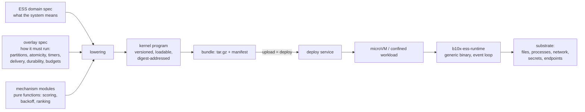
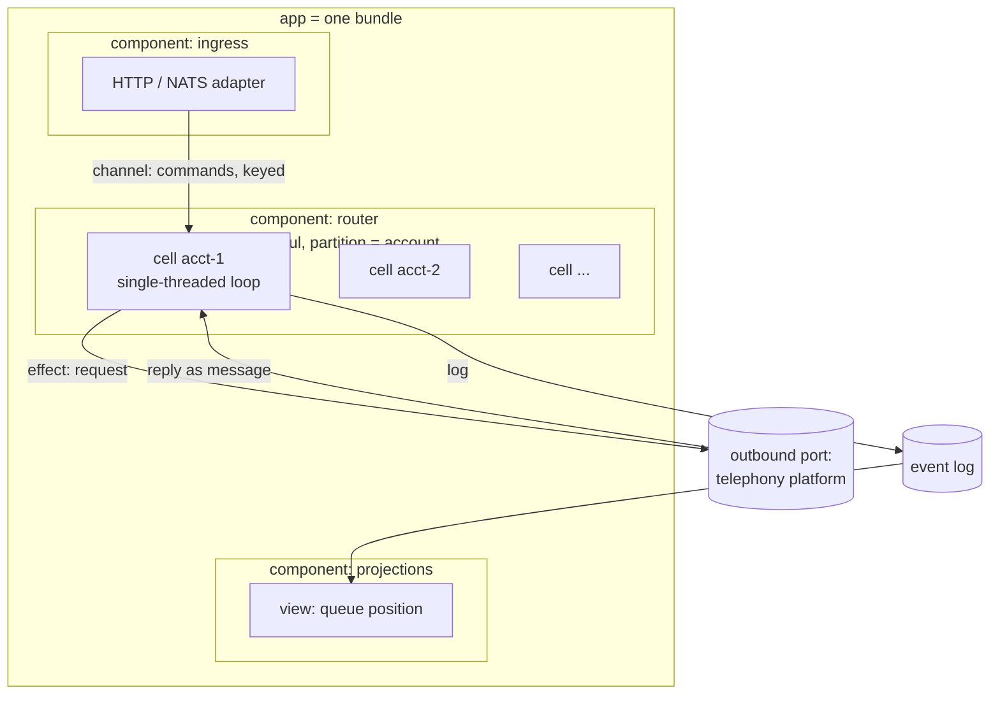
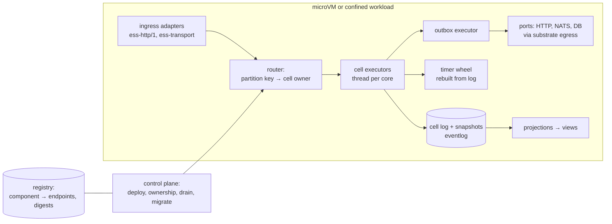

# Spindle: deploy a specification, and a generic runtime runs it

Design, 2026-11-04. Started as a brainstorm; § 3a and § 11 record the operator's decisions of that
day. "The case study" below is a production call-routing service (calls, agents, offers, a backend
that bridges media) whose code and specification were traced outside this repository; only
neutral facts about it appear here.

The survey behind § 2 read ESS 0.58.0 (conclusions re-checked on 0.85.0), substrate, entity-runtime,
eventlog, canon, mantle, loom and workflow on 2026-11-04. Operator decision, 2026-11-04: service-sdk
is out of scope, not read and not depended on; Spindle works at a lower, more technical level.

---

## 1. The idea

Today ESS models the **domain**: entities, lifecycles, commands with outcomes, events, views,
actors, components, bindings. It is used to derive contracts and conformance suites, and its
interpreter (`ess-conformance` `interpret/execute.rs`) runs a model in memory as a test oracle.

The idea: make the specification the deploy unit.

Two properties make it worth more than code generation:

1. **One semantics, three uses.** The kernel program is executed by the production runtime, by the
   conformance oracle, and by a deterministic simulator. A spec that passes conformance in the
   simulator runs with the same instruction semantics in production; there is no generated code
   that can drift from the model.
2. **Deterministic steps.** Every state change is a pure step `(cell state, message) → (new state,
   events, effects)`. Recovery is replay, failover is handing over a log position, and every
   production incident can be replayed offline.

## 2. Where the pieces stand (verified in the source files above)

| need | nearest existing piece | state |
|---|---|---|
| execute commands from a model | ESS model interpreter, `interpret/execute.rs:348` | shipped, test-only; its design forbids use as a runtime (`ess-model-driven-interpretation-design-v0.1.md:150-161`) |
| deterministic guard + transition kernel | entity-runtime `entity-core`, IO-free, `decide_before_load` / `continue_with` | shipped 0.30.3; no loop, no timers |
| ESS → kernel lowering | `ess/crates/generate/ess-entity-runtime` | library only, refuses about 41 constructs, no CLI verb |
| loadable compiled model | none; `EssIr` is unversioned and Serialize-only (`formats.md:161`) | gap |
| guard expressions | `ess_primitives::predicate::Predicate`, three-valued, typed | shipped; no arithmetic |
| communicating machines, channels, logical timers | `ess-protospec/1` sidecar, `ess verify protocol run\|explore` | experimental, model evidence only |
| durable log, snapshots, projections | eventlog 0.9.1 (file, SQLite, PostgreSQL) | shipped; no timers, no push subscription |
| wire bindings | `ess-http/1` (origin/main), `ess-transport/1,2` (NATS subjects) | shipped as contracts; consumer side "not decided" |
| confined execution, egress, secrets | substrate 0.16.1, contract bundle 0.25.0 | shipped; exec needs a timeout, `network_ingress` reserved, no workload/endpoint families |
| microVM | substrate Firecracker driver | proposed; dev nodes have no KVM (`ROADMAP.md:31,48`) |
| VM worker hosting a substrate daemon | mantle (EC2, KubeVirt) | shipped 0.2.0, per-worker VM |
| "generic binary + declared spec + controller" | loom: `agent serve --spec`, `b10x-loom-operator` | shipped for agents on Kubernetes |
| bundle formats | `ess-release-bundle/1`, `ess-runtime/1`, `ess-environment/1` | shipped; target Helm |
| service registry | none; static endpoint maps in `ess-environment/1` | gap |
| durable timers, leases at service level | none (`workflow` lists them as planned) | gap |

## 3. Three layers of a specification

The case study shows what a running service depends on beyond the domain. Sorted by where each
fact belongs:

| layer | says | example from the case study | home |
|---|---|---|---|
| **domain** | what exists, which moves are legal, what each command decides | a call is `Queued → Connecting → Bridged → Ended`; ending an ended call is accepted and changes nothing | ESS, unchanged |
| **mechanism** | how a decision is computed when the domain leaves it open | call score = `rank·0.99 + fifo·0.01`; backoff = `1s·2^n`, cap 30 s, jitter < 500 ms; an unanswered offer is withdrawn after 45 s | overlay + pure modules |
| **run** | what the implementation must guarantee that no single command shows | one writer per account; an agent is in at most one pending offer cluster-wide; outbound connect is at-least-once and the receiver dedups by `seq`; FIFO is by the caller's `queued_at`, not arrival; state survives restart | overlay |

In the case study's specification, every mechanism and run fact above exists only as a YAML comment
citing a source line (verified: comments stripped, no duration, period or score formula remains).
That is the gap this design closes.

## 3a. Semantics in the specification, technicals in the runtime

Operator decision, 2026-11-04: from the application's side a specification states **semantics**;
the **technical** realisation comes from the runtime and is hidden from the application. A
specification never names SQLite, NATS, Redis, Firecracker or an HTTP library. It says what it
needs in its own terms, and the runtime supplies an implementation the environment has.

| the specification says (semantic) | a capability the runtime derives | implementations an environment may have |
|---|---|---|
| an entity outlives a restart | `store.durable` | eventlog over SQLite, PostgreSQL or file |
| an entity exists only while the process runs | `store.ephemeral` | in-memory |
| a guard reads `now` | `clock` | host clock, simulated clock |
| a binding is `periodic`, or a deadline | `timer` | timer wheel rebuilt from the log |
| a component is `reached_by: network` | `ingress.network` | HTTP listener, substrate endpoint |
| a binding crosses to another component | `channel` | in-process queue, TCP between VMs, NATS |
| an outcome is decided `external:` | `external.<cause>` | a named port: HTTP call, named service, a test double |
| a view is `eventual` | `projection` | eventlog projection, in-memory index |

**Capabilities are derived, never authored.** The runtime reads the compiled specification and
lists what it requires; a bundle's author does not write a requirement list, so it cannot drift from
the specification.

**Environment.** Where Spindle runs (OS, arch, substrate backend, a microVM or a laptop) is an
environment, and an environment declares which capabilities it provides and which implementation
backs each one. The same bundle can run on a laptop with `store.durable = sqlite` and
`channel = in-process`, and on three microVMs that each provide the environment `microvm`, with
`channel = tcp`.

**Admission.** Offering a bundle to an environment yields one of:

- admitted, with exactly one implementation bound to every required capability;
- refused, naming every capability the environment lacks.

Several implementations for one capability are chosen by a preference order in the environment,
never by the bundle. This is the domain Spindle specifies about itself: `ess/domains/deployment.yaml`.

What `spindle.deployment` declares, and what stays a runtime rule outside the model:

- **The decision is the admitter's answer, checked by the model.** `DecideAdmission` carries
  `requires`, `bindings` and `missing`, all three answered by admission
  (`spindle_capability::derive` and `admit`); the offer names no capability. A capability bound
  twice is refused first (`bound-twice`). A decision that binds a capability outside `requires`,
  names missing one outside `requires` or one it binds, or leaves a required capability neither
  bound nor missing is refused from the request alone (`not-decided`), whatever the deployment's
  state. A consistent decision on a deployment already decided answers `wrong-state`.
- **The environment provides each binding.** `OfferBundle` refuses an environment nobody declared
  (`unknown-environment`), and `DecideAdmission` reads the deployment's environment.
  `Environment.provides` holds each capability or `prefix.*` key with its implementations
  (`spindle.environment.Provision`), and `DeclareEnvironment` refuses a key listed twice
  (`key-twice`) or one with no implementation (`no-implementation`). A binding is `not-provided`
  when its capability's exact key does not list its implementation, or when it has no exact key
  and `provides` holds no `prefix.*` key at all
  (`crates/spindle-kernel/tests/spindle-kernel/deployment.rs::a_binding_the_environment_does_not_provide_is_not_admitted`).
  Once `provides` holds any `prefix.*` key, no binding whose capability has no exact key is
  guarded, whether or not a prefix key covers it: `laptop.toml` lists `external.*`, so the model
  admits `net.http` bound to `tcp`, which no key of it covers
  (`crates/spindle-kernel/tests/spindle-kernel/adversary_environment.rs::adversary_a_binding_no_key_covers_beside_a_prefix_key_is_left_to_the_runtime`).
  Whether a key covers a capability is a prefix match against a list element, and an ESS 0.90
  string operator compares only with a literal, a view parameter or one command input. The
  runtime decides it: the exact key, else the longest `prefix.*` key that covers the capability
  (`Environment::implementations`). The kernel's admission cases declare the environment expanded
  to the capabilities the bundle requires (`declare_for`), so every binding there is checked by
  its exact key.
- **A refusal names what is missing.** `refused` is eligible only for a consistent decision whose
  `missing` is not empty, and its external cause confirms it; `DeploymentRefused` carries that
  list. A consistent refusal the cause does not confirm is `unconfirmed`. Every invalid answer is
  `AdmissionDecisionInvalid` and changes nothing. The model reads `provides` for `missing` too: a
  refusal naming missing a capability the environment provides by its exact key is
  `missing-provided`
  (`crates/spindle-kernel/tests/spindle-kernel/deployment.rs::a_refusal_naming_a_provided_capability_missing_is_not_refused`),
  so where `provides` holds no `prefix.*` key, a refusal the model takes names exactly the
  required capabilities the environment lacks. A capability named missing that has no exact key
  is never `missing-provided`: once any `prefix.*` key is present, whether the environment lacks
  it is left to the runtime.
  ESS 0.90 synthesises neither the forced `refused` scenario beside a `when_related:` refusal
  over a stored reference (ESS-SYNTH-003, "such a reference is not arranged for an external
  branch") nor `missing-provided` (ESS-SYNTH-003), and an `external:` branch may not carry
  `when_related:` (ESS-COMMAND-004); the kernel tests above decide both.
- **The ranking is declared; taking the first is a runtime rule.** `provides` lists each key's
  implementations most preferred first, as the environment document does. The model holds the
  bindings admission chose, and `spindle_capability::admit` takes the first implementation of
  the key that provides each capability
  (`crates/spindle-kernel/tests/spindle-kernel/deployment.rs::preference_order_is_declared`).
- **`requires` is the admitter's answer, and its value is derived.** ESS cannot compute a list
  from a bundle digest, so `DecideAdmission` takes `requires` from the admitter, which passes
  exactly what `spindle_capability::derive` computes from the bundle's compiled specification;
  the bundle's author never writes it (`requires_is_tied_to_the_bundle`). ESS 0.90 has no actor
  `summary:`, so this is stated on the input and the outcomes. No runtime path issues
  `DecideAdmission` yet; the rule binds the one that will.
- **A stop ends an admitted or running deployment.** `StopDeployment` moves `Admitted` and
  `Running` to `Stopped`: an admitted deployment that never started can be stopped. On an
  `Offered`, `Refused` or `Stopped` deployment it is accepted and changes nothing; it does not
  withdraw an offer, which admission can still decide (`stop_from_admitted_and_offered_is_stated`).

**Overlay: open.** Whether a separate overlay document is needed is undecided (operator,
2026-11-04: "it might have an overlay or not"). The facts in § 3 that are run-level (partition key,
atomicity scope) have two possible homes: an optional overlay, or defaults the runtime applies
(one cell per entity instance; atomicity is one command on one instance). Spindle starts with the
defaults and adds an overlay only when an example cannot run correctly without one.

### Why an overlay and not more ESS

Per operator: an addition goes into ESS only if it helps without the VM use case.

| candidate fact | useful without a runtime? | goes to |
|---|---|---|
| set-level uniqueness ("a matched element cannot be matched again"); ESS refused `unique:` on a view | yes: conformance could check it | ESS (proposal) |
| per-entity deadline ("expires 45 s after it entered `Connecting`") | yes: conformance could drive time and check the move | ESS (proposal) |
| a store two components share | yes: today's boundary spec cannot state the second coupling | ESS (proposal) |
| partition key, ownership, atomicity scope | no | overlay |
| delivery and dedup keys on outbound calls | partly (bindings already carry `delivery:`) | overlay, refining the binding |
| scoring and backoff formulas | no (ESS records "synthesize arbitrary business algorithms" as a non-goal) | mechanism module |
| durability, snapshots, retention | no | overlay |
| latency and throughput budgets | no | overlay |
| placement (thread, VM, replica count) | no | deployment document, not the overlay |

The overlay references the domain spec by digest, as `ess-realization/1` and `ess-transport/1`
already do. ESS keeps its boundary rules (`AGENTS.md`: no `ess-ir/2` plan, no generic facet
registry), and the overlay is free to be runtime-specific.

## 4. The running app

| unit | meaning | concurrency | declared in |
|---|---|---|---|
| app | components + channels, one deploy | many VMs possible | bundle manifest |
| component | one kind of state machine with one partition key, or stateless | pool of workers | overlay |
| cell | all instances sharing one partition-key value | one deterministic loop; no locks inside | overlay (`partition`) |
| channel | typed queue between components: delivery, order scope, bound, overflow rule | in-process queue or network, same meaning | overlay |
| effect | outbound request, timer, publish | executed after the step commits (outbox) | kernel program |
| timer | durable wake-up addressed to a cell | stored in the cell's log | kernel program |

Concurrency comes from many cells; a cell itself is serial. This is the model of Erlang/OTP
processes, Orleans grains and Restate services, and a Rust runtime can carry it on a thread-per-core
or a work-stealing scheduler. The semantics never depend on placement: two cells on one thread and
two cells in two VMs exchange the same messages with the same guarantees, so placement and replica
counts are a deployment decision changed without touching the spec.

**Atomicity across entities.** The hard case in the case study is the match: one step must move a
call and reserve an agent. The overlay names the atomicity scope, and the lowering refuses a kernel
program whose step touches two cells. Two ways to satisfy it:

| option | how | cost |
|---|---|---|
| **A. co-locate** | partition = account, so the call and the agent are in one cell | one account's throughput is one core; simplest; matches how the case study already runs (one actor per account) |
| **B. reserve-then-commit** | the agent cell grants a lease, the call cell commits, the lease is confirmed or expires | scales past one core per account; needs a timeout and a compensation on every step |

Recommendation for a prototype: A. The case study runs A today and its throughput is dominated by
the outbound round trip (case study § 4).

## 5. The kernel program and its instruction set

Not bytecode: a typed, structured program per handler, a tree of the instructions below. A handler
is selected by message type; it runs to completion inside one step; it never blocks.

| group | instruction | meaning |
|---|---|---|
| read | `load(entity, id)` | read one instance from the cell |
| | `scan(index, filter, order, limit)` | ordered read over a cell-local index (views lowered to indexes) |
| decide | `guard(pred) else refuse(error)` | three-valued; `unknown` refuses |
| | `branch [(pred, block)…] otherwise block` | outcome selection, precedence from the ESS selection plan |
| write | `create`, `set`, `move(transition)`, `delete` | checked against the lifecycle and invariants before commit |
| | `emit(event, payload)` | appended to the cell log in the same commit |
| compute | `eval(expr)` | total expression language: ESS predicates plus integer/decimal/duration arithmetic, min/max, clamp |
| | `call_pure(module, fn, args)` | WASM function, no imports, fuel-limited, deterministic; for scoring and ranking |
| | `random(seed_scope)` | deterministic PRNG seeded from (cell, log position), for jitter |
| coordinate | `send(channel, key, msg)` | to another cell or component; delivered after commit |
| | `request(port, req, correlate)` | outbound call through a declared port; the reply, timeout or failure returns as a message |
| | `claim(index, filter, order)` | take the first matching element and mark it taken in the same step: the matching primitive |
| | `lease(target, ttl)` / `release` | option B above |
| time | `timer_set(name, at \| after)`, `timer_cancel(name)` | durable; fires as a message; a re-set replaces |
| | `every(period, handler)` | cell-scoped sweep, lowered to a self-re-arming timer |
| | `now` | the step's clock, fixed per step and recorded in the log |
| identity | `dedup(key, window)` | the second message with the key gets the first reply |

Step semantics:

1. A message arrives at a cell (command, reply, timer, delivered event).
2. The handler runs against the cell state; reads see only the cell.
3. The result is one record: events, state delta, outbox (sends, requests, timer changes),
   the step's `now` and PRNG position.
4. The record is appended durably; then the outbox is executed.
5. A crash between 4 and the outbox replays the outbox from the log; ports are at-least-once and
   the receiver dedups (the overlay names the key).

The instruction set is small enough to implement twice (Rust runtime, and the oracle inside
`ess-conformance`), which is what keeps the simulator and production on one semantics.

### Lowering examples from the case study

| behaviour | lowered to |
|---|---|
| submit a call | `guard(not exists) else refuse(AlreadyQueued)`; `create`; `emit(CallQueued)`; `send(trigger-eval)` |
| match | on `every(1s)` and on availability messages: `claim(available_agents, selection ∈ call.selections, order by score)`; `set(call.agent)`; `move(dispatch)`; `request(platform.connect, {seq, call, agent})`; `timer_set(offer-timeout, after 45s)` |
| offer not answered | `timer(offer-timeout)` → `move(requeue)`; `release(agent)` |
| connect failed, transient | `eval(backoff = min(1s·2^n, 30s) + random(0..500ms))`; `timer_set(retry, after backoff)` |
| backend reports bridged | `dedup(call, seq)`; `move(bridge)`; `timer_cancel(offer-timeout)` |
| hang-up | `move(end)`; `emit(CallEnded)`; idempotent: `guard(state != Ended) else accept` |
| agent available again | inbound status message → `set(agent.line_status)`; availability recomputed by `eval`; no timer (the platform owns wrap-up) |

Things the case study does that this set cannot express without a new instruction: a 60 s pass
that reads another system's database and repairs state from it. That is the "shared store" item in
§ 3; in the runtime it becomes a `request(port: platform-db, query)` on `every(60s)` and the diff is
applied by `eval` + `set`. It is expressible, but only as an explicit port, which is the point.

## 6. Runtime architecture

- **Ownership.** A cell has exactly one live owner. Ownership is a lease in the control plane,
  fenced by log position: the new owner replays to the fence before taking traffic. The case study
  shows what happens without fencing (every replica owns every shard; double connects possible).
- **Durability.** One log per cell (or per component with cell id in the record); snapshot every N
  records; snapshots are caches and can be dropped.
- **Timers** live in the log as records; the in-memory wheel is rebuilt on replay.
- **Ports** are the only I/O. Each is declared in the overlay with protocol, delivery, dedup key,
  timeout, and the substrate egress aperture it needs. A bundle that uses an undeclared port does
  not load.
- **Views** are projections over the log, with the consistency the ESS view declares
  (`read_your_writes` reads through the owning cell; `eventual` reads the projection).

## 7. Deploy

| step | what happens | refuses when |
|---|---|---|
| 1. bundle | `tar.gz`: ESS sources, overlay, mechanism `.wasm`, compiled kernel program, manifest (digests, ESS version, kernel-program format version, runtime ABI, ports, egress, stores) | a digest does not match the sources |
| 2. upload | deploy service stores it by digest | a format version the runtime does not read |
| 3. verify | recompile and compare digests; run the ESS conformance suite against the kernel program in the simulator; run the overlay's run-level checks (uniqueness, ownership) under simulated faults | a scenario fails, a run-level check fails |
| 4. diff | `ess verify diff` against the running revision; classify each change as compatible, needs state migration, or breaking | breaking without a migration in the bundle |
| 5. place | provision VM or confined workload through substrate; register endpoints | a capability is missing (ingress, KVM) |
| 6. cut over | per cell: drain, fence, new revision replays (with migration), takes traffic | replay fails; then the old revision keeps the cell |
| 7. rollback | re-fence to the old revision while the new log suffix is compatible | the new revision wrote events the old one cannot read |

State migration is the part with no existing design (`ess-capabilities.md` § 6: `DataMigration`
is historical and unimplemented). A live call router cannot be redeployed by "stop, start".

## 8. Can a Rust VM carry an async, high-throughput service?

Yes, with these conditions (design reasoning, not measured):

- **Interpretation cost.** A step is a few dozen instructions over in-memory state. In the case
  study, the reimplementation's own README reports a matcher hot path at p50 ≈ 180 µs and an
  end-to-end connect of about 150 ms dominated by the platform round trip (claims from that README,
  not measured here). An interpreter adding microseconds per step is not the bottleneck there.
- **Hot computation** (scoring over many candidates) runs in `call_pure` WASM or, later, as a
  native built-in named in the overlay, not as interpreted expressions.
- **Back-pressure** is a channel property in the overlay (bound, overflow: block, shed, or refuse
  the command), so overload behaviour is part of the spec and testable in the simulator.
- **Determinism and async coexist** because every await is outside the step: a request is an
  effect, its reply is the next message.

## 9. Q1 in brief: replicate from specs alone

The full analysis is kept outside this repository. What it shows:

| class of fact | in the spec today | clean-room result |
|---|---|---|
| lifecycles, commands, outcomes, idempotent edge cases | typed | reproduced; conformance holds them |
| timers, backoff, scoring formula | YAML comments only | lost if comments count as docs; guessed otherwise |
| second coupling (direct reads/writes of another system's DB) | stated as unmodellable | service cannot cold-start |
| cluster ownership, dedup, durability, wire formats of the log | absent | invented; behaviour under failover unknown |

The domain spec is enough to reproduce the contract and the edge cases written as outcomes. It is
not enough to reproduce a service that behaves the same: every fact that decides *which* agent,
*when*, and *what happens on failure* is mechanism or run level.

## 10. Q2 in brief: does the logic lower to a generic instruction set?

Yes for every step of the traced slice (§ 5 table), with two conditions:

1. `claim` (atomic take from an ordered index) and durable timers are first-class instructions.
   Without them the matcher and the offer timeout are not expressible.
2. Scoring is a pure module. The case study's scoring formula and tie-breaker have already diverged
   once between two implementations written from the same code; a pure module is one copy for all.

No step needed a general-purpose loop over unbounded data inside a handler; the sweeps are timers
plus bounded `scan`.

## 11. Decisions and open questions

Decided by the operator, 2026-11-04:

| decision | consequence |
|---|---|
| its own repository, `beyond10x/spindle`; binary `b10x-spindle` | ESS gets at most the three proposals in § 3 |
| guards are ESS's: `ess_primitives::predicate::Predicate`, compiled by `ess-compiler` | no second guard dialect; Spindle depends on ESS crates at a released tag |
| application specs carry semantics only; technicals come from the runtime (§ 3a) | capabilities are derived from the spec; environments bind implementations |
| service-sdk is out of scope | not read, not depended on |
| an overlay may or may not exist | defaults first (§ 3a) |
| Spindle itself is specified in ESS and planned in AEP | `ess/`, `.engineering/planning/` |
| showcase: a two-player paddle-and-ball game, three components, each in its own microVM, talking over channels | `examples/rally` (§ 13) |
| HTTP ingress (2026-11-05): ESS's published contract, everywhere: routes where `ess generate --kind openapi` publishes them, ESS's derived routes or, with an `ess-http/1` binding compiled by ESS, its method, path, path variables and status per outcome, derived routes for what it does not name; no route of Spindle's own | `crates/spindle-ingress`; a command answers ESS's envelope `{outcome, published, error?, payload?}`, a view the `{rows}` ESS projects; request refusals as ESS's server makes them (400, 404, 405, 411, 413); `http-loopback` only |
| unmet binding input (2026-11-05): an event binding whose input the event does not fill (a required field absent, or a value carried across a declared conversion that is no value of the input's type) invokes nothing; the event's other bindings still run, and the binding is reported as a command that did not execute | ESS 0.86.0's interpreter calls this an unmet input obligation only for an `on_refusal` binding and answers every other one unsupported (`interpret/bindings.rs`), so ESS defines no result; Spindle has already committed the command that published the event, so it neither undoes that nor stops its siblings. `spindle_channel::Unmet`, `Report::failed` with `Cause::Delivered` |
| fixed caller (2026-11-06): a test-backend switch, not authentication. `run` serving HTTP takes `--fixed-actor <actor>` with `--fixed-caller <JSON object>`, opt-in only, no default; every command a request names is then sent as that actor and caller, so a command that reads its caller is served | the request proves nothing about who sends it; the switch exists so a browser suite can drive a specification in memory. The actor and caller are bound against the model before listening (an undeclared actor, an undeclared attribute or a required one left out exits 1, naming it) and printed on stderr before the first request. The grant check still runs on every command: one the fixed actor's `may:` does not name answers ESS's standard `403 {"refused": "not granted", "actor"}`, and nothing is written; so does a read-granted view (`x-ess-may-read`) the fixed actor may not read, before reading. Without the switch a command that reads its caller stays `501`. `--fixed-actor` may be given more than once, the n-th `--fixed-caller` the n-th actor's (one actor alone may leave it out; an actor given twice exits 1), so one run can back screens spanning several actors' domains: each command is sent as the first fixed actor whose `may:` names it, a read-granted view read as the first that may read it, and an operation none may run answers the standard 403 naming the first given; each actor is printed on stderr in order. `spindle_ingress::Caller`, `Surface::fixing_caller`, `Surface::fixing_callers` |
| external cause bound to an HTTP call (2026-11-10), where the environment declares it: `spindle-environment/1` is extended in place with optional `[http.<name>]` tables (`method`, `url`, `timeout_ms`, `secret_env`), and an `external.<command>.<outcome>` key of `provides` whose admitted implementation is `<name>` is answered by that call | a document without `[http]` parses and serialises as before, so no `Environment::parse` caller changes; a table no `external.` key lists, one a non-`external.` key lists, a `timeout_ms` outside 1 to 30000, a `url` carrying userinfo (`user:password@`, refused naming the table, the URL never printed) or a `secret_env` that is not a variable name is refused at parse. An implementation that names no table keeps today's answers (request line, `--decisions`, `--answer-default`, a world's table). `spindle_capability::Environment::http` |
| the request payload of such a call (2026-11-10): ESS 0.90 declares no construct for it (`external:` carries one cause phrase, `ess-http/1` binds inbound routes, `ess-transport` events), so Spindle sends its own `spindle-external/1` JSON body: `format`, `capability`, `command`, `outcome`, `cause` and the command's `input` as the kernel asks the cause (`spindle_kernel::External`) | one request per cause the kernel asks, at most once per command run (the kernel keeps each answer for the run); a `2xx` reply `{"holds": true \| false}` answers it and the outcome it selects is committed; a reply body is read up to 64 KiB (`calls::REPLY_LIMIT`); a timeout, a transport failure, another status, a longer or another body answers nothing and the command fails `undecided`, changing nothing (`501` when served). Revisit if ESS adds an outbound payload construct |
| where the HTTP call is made (2026-11-10): in `spindle-cli` (`calls.rs`, hyper's client on a current-thread tokio runtime, already in the lock), as one more `Decider` laid over `run`'s | `spindle-host` and `spindle-capability` compile into the browser worker (`spindle-wasm`) and get no HTTP client; the kernel is unchanged. `run` asks the call in both modes: a stdin line's cause before its own `external` object, a served request's before the world's table and `--decisions`; a served run whose every external cause is bound to a call needs neither `--decisions` nor `--answer-default`. `http://` only; `Host` is the URL's `host[:port]`. A call blocks the caller's thread until its reply or its timeout: served, that is the one thread that runs every command, so every other request waits behind it, at most `timeout_ms`, which the document bounds at 30 s. Under `--observe` the observed decider answers through the calls too: a cause a call answers is listed in the request's `externals` and counted in `spindle_external_causes_total` with the source `call` (`spindle.observe.AnswerSource`), and one whose call failed as `unanswered`, as any cause a `501` leaves. `--scenario`, `conform`, `play` and the Service Worker do not call |
| a secret by reference (2026-11-10): `secret_env` names an environment variable, read once when `run` starts and sent as `Authorization: Bearer <value>` | no document holds the secret, and no message prints it; an unset variable exits 1 before the first request, naming the variable and the call |

Runtime defaults, 2026-11-05:

| default | consequence |
|---|---|
| `on_failure: retry` (no `retry:` bound) makes at most 5 attempts per envelope: the first and four retries, each run at once on the host's thread, with no backoff (`spindle_host::RETRY_ATTEMPTS`) | ESS bounds no unbounded retry; a refused attempt and one the kernel does not execute are both retried. The next envelope runs only once the retry has settled, so a retry never reorders later events. The last failure is reported once, with its attempt count, and never run again. `binding.<binding>.attempted` counts every attempt and `binding.<binding>.exhausted` every invocation given up, on the component that invokes. `--drop-retries` stays as an explicit opt-out that runs such a binding as `drop`; A policy chosen per refusal (`on_failure: {drop: [...], retry: {except: [...]}}`, compiled to `on_refusal`) is answered after every attempt by that attempt's refusal, or its fallback for a failure with no declared outcome, through ESS's `ResolvedRefusalPolicy::select` (`spindle_channel::Route::answer`): `drop` ends the occurrence at once, `retry` goes on within the same 5 attempts in all, whichever refusals answered them. A bounded `retry:`, universal or in `on_refusal`, and an `escalate` in `on_refusal` stay refused by name. A peer's frame does not set the policy: the receiving host retries what its own routes say. The runtime keeps giving up after 5; only the conformance target (`HostTarget`, `run --scenario`, `conform`) answers a step whose retry gave up as unsupported, as ESS's interpreter does ("unbounded retry exceeded the finite execution budget") |

Open:

| question | default |
|---|---|
| does the kernel program extend `entity-core` or stand alone | stand alone at first, with ESS `Predicate` for guards; revisit once the instruction set settles |
| arithmetic beyond `increment:` | none in M0; the `rally` example is written on an integer grid with `increment: 1` / `-1` |
| AppSpec above ESS | deferred: the measured gaps are below ESS, not above |
| how an HTTP caller proves its actor and attributes (authentication) | undecided; a command that reads its caller answers `501` unless the test-backend switch fixes one caller for the run |
| whether a Service Worker serves the console routes (`ingress.network` bound to `service-worker`, `spindle-wasm`) | served, as on `http-loopback`: a Service Worker is reached only by the pages of its own origin, the reach the loopback address gives the listener; a reset that carries a world is refused there, and a reset removes every instance of each IndexedDB store rather than replacing it |
| substrate gaps (ingress, workload/endpoint, Firecracker) | M0–M2 run as host processes; microVMs once substrate's Firecracker driver exists or with a local Firecracker launcher |

## 12. Milestones (simplest path first)

| # | deliverable | proves |
|---|---|---|
| M0 | load and compile an ESS spec; derive its capabilities; admit it against an environment; run commands on one thread with in-memory and SQLite eventlog stores; `b10x-spindle check`, `admit`, `run` | spec → load → admit → serve, no codegen |
| M1 | bindings between components over channels (in-process, then TCP); periodic bindings on a durable timer; `external:` through named ports | timers and effects in one semantics |
| M2 | `examples/rally` as three processes on one host | the showcase, before VMs |
| M3 | each component of `rally` in its own microVM, channels over the VM network | "three things deployed, each in one Firecracker" |
| M4 | bundle (`tar.gz` + manifest), deploy service, registry | "upload = deploy" |
| M5 | cells across threads; ownership leases with fencing; snapshots | concurrency and HA semantics |

## 13. Showcase: `rally`

An original two-player paddle-and-ball game, written as an ESS system of three components. It is
our own design (rules, names, look); it borrows only the genre.

| component | owns | does |
|---|---|---|
| `rally-table` | the match: ball position and direction on a grid, both paddles, score, serve, winner | on each `Tick` (periodic binding) moves the ball one cell diagonally, serves it or turns it; bounces off walls and paddles; a ball past a paddle is a point; first to a target score wins |
| `rally-player-west` | one player: a copy of its paddle row and of the ball | on `BallMoved` decides by rule whether to move its paddle up, down or hold, and asks the table to move it |
| `rally-player-east` | the same rules for the other side | the same |

Communication is bindings only: the table publishes `BallMoved`, `PointScored`, `MatchWon` and
`PaddleMoved`; each player's binding turns `BallMoved` into its own `ObserveBall` command, and the
player's `PaddleMoveRequested` event binds to the table's `MovePaddle`. `PaddleMoved` is published
for observers, as `PointScored` and `MatchWon` are: no binding consumes them.

The rules, each declared in `examples/rally/ess/` and checked by
`crates/spindle-kernel/tests/spindle-kernel/rally.rs`:

- **A tick moves the ball, serves it, turns it, scores or ends the match.** `Tick` answers with
  the first declared branch whose guard holds. A plain move shifts the ball one cell across and
  one cell up or down. A serve changes only the state, from `Serving` to `InPlay`; a paddle return
  or a wall bounce changes only the heading; both leave the ball where it is, so the next tick
  moves it. A point puts the ball back in the middle and the match back to `Serving`, and a
  winning tick ends the match in `Won`.
- **The grid is an invariant.** The ball stays in columns 1 to 14 and rows 0 to 8, each paddle in
  rows 0 to 8; `rally.table.Match`, `rally.west.Player` and `rally.east.Player` declare these
  bounds as invariants, which the terminal frame relies on (`crates/spindle-host/src/rally.rs`).
  The kernel refuses a step that would break one, and the kernel tests
  (`crates/spindle-kernel/tests/spindle-kernel/rally.rs`) put a row one cell past each bound. ESS's synthesized
  suite checks the invariants only after the branches it reaches (3 of the 13 state-changing
  `Tick` branches), and no synthesized scenario offers a value outside the grid and expects it
  refused.
- **A winner means a won match.** An invariant ties a non-empty `winner` to state `Won` and `Won` to
  a winner, whose side needs no more points; a caller that ends play on a winner reads a match that
  is over.
- **A match to fewer than one point is refused.** `OpenMatch` with `target_score` below 1 answers
  `target-too-low` with `TargetScoreTooLow` and opens nothing, because such a match could never be
  won; `target_score >= 1` is also an invariant.
- **Values change by increments, with two exceptions.** Every move of the ball and of a paddle is
  a guard plus `increment:` on an integer field, so the game needs no arithmetic the language
  lacks. A point puts the ball back in the middle with literals (`ball_x: 8`, `ball_y: 4`), and a
  player copies the values its `ObserveBall` input carries into its own fields.
- **The table owns both paddles.** Only `MovePaddle` moves one. Each player holds a copy of its
  paddle row and of the ball, refreshed from every `BallMoved`; asking to move changes neither the
  paddle nor the copy, which waits for the next ball.
- **First sight seats the player.** A player's first `ObserveBall` of a match answers
  `first-sight`: it records the ball and its paddle and emits `BallSeen`, asking for nothing
  wherever the ball is. From the next ball on it asks up or down, or holds.
- **Bindings deliver at most once and drop.** Every rally binding declares
  `delivery: at_most_once` with `on_failure: drop`, because a step of the game is worth nothing
  late: a lost tick is replaced by the next tick and a lost `BallMoved` or `PaddleMoveRequested` by
  the next ball, so nothing is retried or reported. ESS therefore synthesizes no redelivery
  scenario for the four event bindings and refuses each one as `ESS-SYNTH-010`
  (`<binding>/binding/delivery`).

Deployed on microVMs, it is one deployment: the bundle offered once to the environment `microvm`
(`channel = tcp`), whose `requires` is what the whole bundle requires. Its three components are
three placement instances of that deployment, each on its own microVM target, and every target
provides the same environment. A deployment has one environment, so a component's bindings are the
deployment's bindings for the capabilities that component uses
(`crates/spindle-kernel/tests/spindle-kernel/deployment.rs::one_bundle_in_three_environments_is_decided`). On a
laptop the same bundle runs with `channel = in-process`, and admission is the only thing that
differs.

